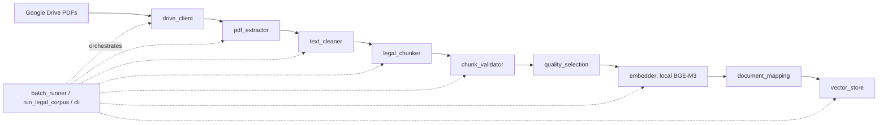

# Legal ingestion dataflow

This guide maps the legal-document ingestion code in this directory: what each stage receives, what it produces, and how the stages fit together. The corpus runner is resumable and keeps Drive source IDs distinct from database document UUIDs.

## End-to-end flow



The normal sequence is discovery/download, extraction, cleaning, legal chunking, validation, quality review, embedding, then storage. The general CLI can run stages separately. The corpus runner adds pilot checks, resumability, and post-write verification. Chunking and validation can be run without embeddings or database writes.

## Modules

| File | Responsibility and output |
|---|---|
| [drive_client.py](drive_client.py) | Authenticates with a service account using environment configuration; traverses folders; lists PDF IDs, names, sizes, modification data and Drive links; downloads PDFs to a temporary/local processing location. The Drive ID is the stable source identity. |
| [pdf_extractor.py](pdf_extractor.py) | Extracts each PDF page using PyMuPDF and returns page-number/text records. Pages are one-based. It does not run OCR; low-text pages are reported for review. |
| [text_cleaner.py](text_cleaner.py) | Cleans extraction artifacts for parsing while retaining the unmodified extracted page text separately. This separation supports exact reconstruction checks against source extraction. |
| [legal_chunker.py](legal_chunker.py) | Main generalized legal structure parser. Detects front matter/body, Parts, Chapters, Sections/rules, subsections and clauses; carries hierarchy only where supported by the text; records page provenance and offsets. Keeps text lossless and emits fallback chunks for text it cannot classify. It targets about 1,200 words and splits large provisions at structural/paragraph/sentence boundaries. |
| [chunker.py](chunker.py) | Compatibility API for older callers. The generalized `chunk_legal_document` path delegates to `legal_chunker.py`; legacy APIs remain for existing consumers. The Drive corpus path uses the generalized parser. |
| [chunk_validator.py](chunk_validator.py) | Checks chunk shape, required fields, indexes, metadata formats, page ranges and exact ordered text reconstruction. It reports problems; it does not silently repair or delete chunks. |
| [quality_selection.py](quality_selection.py) | Partitions validated output into accepted, rejected and quarantined sets, retaining source text and reasons. Rejected/quarantined data remains available for review and is not sent to embedding/storage in the curated corpus run. |
| [document_processor.py](document_processor.py) | Reusable single-document orchestration: extract, clean, chunk, attach source/document metadata, and validate. Supports dry processing without embedding or database writes. |
| [batch_runner.py](batch_runner.py) | Resumable Drive batch stage. Writes per-PDF chunk JSON plus a checkpoint/report under processed outputs; uses source identity and file state/checksum to avoid needless reprocessing. |
| [batch_validator.py](batch_validator.py) | Rechecks generated batch artifacts against PDFs and summarizes structural/provenance/text issues in validation reports. |
| [embedder.py](embedder.py) | Provides Gemini compatibility and local BAAI/bge-m3 embedding implementations. The corpus run uses local BGE-M3 dense vectors (1,024 dimensions), with validation, checkpoint/cache support, batching and recovery behavior. No API key is needed for the local model. |
| [document_mapping.py](document_mapping.py) | Maps a Drive PDF to one `legal_documents` row. `source_drive_file_id` identifies the source; the database creates a distinct UUID `id`; all its chunk rows reference that UUID. Repeated runs look up by source ID. Title/source URL are sourced from Drive metadata; citation details are not invented. |
| [vector_store.py](vector_store.py) | Inspects the existing schema and maps validated documents/chunks to its existing tables. Checks required columns, relationships and vector dimensions, then performs guarded/idempotent upserts. It does not create a parallel corpus schema. |
| [run_legal_corpus.py](run_legal_corpus.py) | Staged end-to-end corpus runner. Reprocesses and verifies a pilot document before allowing the full run; then embeds, stores, verifies links and writes final reports. |
| [cli.py](cli.py) | Command-line entry point for independently running discovery, extraction, cleaning, chunking, validation, embedding and schema inspection/storage. Storage is guarded: dry-run by default and explicit write/approval flags are required. |
| [README.md](README.md) | Setup, configuration and command reference for the ingestion package. |

## Important data and identity rules

- A Drive file ID is a source identifier, not the database document primary key.
- Each distinct Drive PDF maps to one `legal_documents` UUID. Chunks from that PDF share that UUID in `legal_chunks.document_id`; different PDFs remain distinct even when titles match.
- Chunk metadata retains the Drive file ID/source information, title, jurisdiction, hierarchy, chunk index, page range, and original text as available.
- The current jurisdiction helper labels a title beginning with “Kerala” as `state`, otherwise `central`. Treat this as a corpus convention, not a general legal classification rule; review titles that do not encode jurisdiction reliably.
- Document type can remain unknown when source metadata does not establish Act/Rule status. Citation fields stay empty unless verified.
- Text extraction is not OCR. Low-text pages are flagged; their text must not be described as OCR-corrected.

## Outputs and reports

Generated chunk/checkpoint data lives under `services/rag/processed/legal_chunking/` and is ignored by Git as configured in the repository [.gitignore](../../../.gitignore). Corpus reports are under [reports/legal_chunking](../reports/legal_chunking/): [drive_batch_report.md](../reports/legal_chunking/drive_batch_report.md), [drive_validation_report.md](../reports/legal_chunking/drive_validation_report.md), [final_ingestion_report.md](../reports/legal_chunking/final_ingestion_report.md), and its machine-readable [JSON report](../reports/legal_chunking/final_ingestion_report.json). These reports record the outcome of a particular run; rerun the pipeline before relying on them after changing inputs or code.

Quality selection previously identified 49 Drive PDFs, excluded two non-corpus items (including `test_order.pdf`), and processed 47 legal documents. At the reported run, 6,038 chunks were accepted, 12 rejected, and 139 quarantined. The 18 low-text document/page pairs were flagged for OCR review; no OCR was performed. These are recorded run results, not guarantees about later files or reruns.

## Tests and dependencies

Service and parser tests are in [test_ingestion_services.py](../test/test_ingestion_services.py), [test_legal_chunker.py](../test/test_legal_chunker.py), and [test_quality_selection.py](../test/test_quality_selection.py). Existing extractor, cleaner, chunker and processor tests are [test_pdf_extractor.py](../test/test_pdf_extractor.py), [test_text_cleaner.py](../test/test_text_cleaner.py), [test_chunker.py](../test/test_chunker.py), and [test_document_processor.py](../test/test_document_processor.py). Run the package suite from the repository root with:

```powershell
python -m pytest services/rag -q -p no:cacheprovider
```

Install the core dependencies from [requirements-ingestion.txt](../requirements-ingestion.txt). Local embedding dependencies are separated in [requirements-bge-m3.txt](../requirements-bge-m3.txt); install them only when using BGE-M3. Configure credentials in environment files and never commit service-account keys, database URLs, or API keys.

## Suggested reading order

1. Read [README.md](README.md) for setup and commands.
2. Follow `document_processor.py` for one document, then `batch_runner.py` for Drive batches.
3. Read `pdf_extractor.py`, `text_cleaner.py`, `legal_chunker.py`, and `chunk_validator.py` for the text path.
4. Read `quality_selection.py` to understand curation, then `embedder.py` and `document_mapping.py` for vector preparation and identity.
5. Read `vector_store.py` and `run_legal_corpus.py` for guarded database writes and final checks.

The design keeps extraction, parsing, validation, embedding and storage as separate services so that parsing can be inspected without invoking a model or writing to Supabase.
